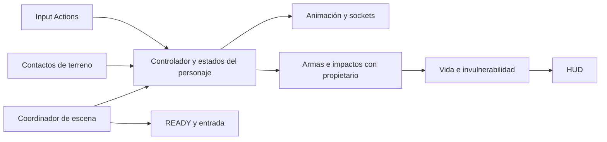

# Qué aprovechar de los cuatro repositorios para Mega Man X9

Revisión técnica del **24 de octubre de 2026**, aplicada a `C:\Users\hallo\Mega Man X9`, Unity **6000.6.4f1**, URP 2D e Input System 1.20.0. El objetivo es desarrollar un juego propio de acción y plataformas con respuesta y presentación cercanas a X4/X5/X6.

**Decisión recomendada:** conservar este proyecto Unity y su biblioteca de arte; usar **GameMaker para estudiar la amplitud de comportamiento**, **sozud/mmx4 para contrastar reglas precisas de X4**, **Recomp para diseño de pruebas, convivencia de sistemas y casos difíciles**, y **ShadowMasterX5 como prototipo C# acotado**. Importar cualquiera de los cuatro completos no resuelve el juego actual y, en varios casos, introduce dependencias ajenas o referencias rotas.

Esta decisión es una **inferencia de compatibilidad**, sustentada en los archivos citados. Se distingue de las funciones comprobadas leyendo código y de las correcciones que ya se ejecutaron en Unity.

## Evidencia y alcance

Se inventariaron recursivamente los cuatro repositorios sin truncamiento. Se descargaron y verificaron **182 archivos de texto seleccionados** mediante SHA-1 de objeto Git en `source_inventory.json`, además de fuentes previas y suplementos documentados en los análisis individuales. Descargar y verificar no equivale a auditar cada línea: se inspeccionaron las funciones y datos relevantes para los sistemas de esta tabla y los informes individuales. No se ejecutaron instaladores, herramientas ni pruebas de los repositorios externos.

| Repositorio y revisión | Naturaleza | Archivos del índice completo | Función en el proyecto |
|---|---|---:|---|
| [sozud/mmx4 · 6a6b4555](https://github.com/sozud/mmx4/tree/6a6b4555e775820b5f4e45c6f50bd5859223a453) | Decompilación C de X4, con rutas por plataforma | 1.544 | Reglas, prioridades, estados, cajas y tiempos originales |
| [Dragon-Developer/Mega-Man-X-Engine · 69f68c36](https://github.com/Dragon-Developer/Mega-Man-X-Engine/tree/69f68c3658dba9ad05c94a9a4f1bbc4d28315bd7) | Framework GameMaker, runtime declarado 2023.6.0.139 | 17.919 | Catálogo amplio de acciones, personajes, jefes y efectos |
| [mstan/MegaManX4Recomp · 80325966](https://github.com/mstan/MegaManX4Recomp/tree/803259663dce7251b1a80c5646df2cb18eeaf308) | Recompilación nativa con modificaciones y herramientas | 246 | Ciclo de vida, propiedad del combate, cámara y validación |
| [ShadowMasterX5/MegamanX4 · c0d70c0a](https://github.com/ShadowMasterX5/MegamanX4/tree/c0d70c0a69fa626ee686498476e59a5941d4599f) | Prototipo Unity 2021.1.19f1 | 6.045 | Ejemplos pequeños de componentes C# y Animator |

El tamaño de ShadowMasterX5 engaña: aproximadamente el 97 % de sus blobs están en `Library`; su inventario de `Assets` contiene 11 scripts propios y código de Standard Assets. Su tamaño no significa que contenga un juego completo. Las revisiones y árboles canónicos están separados en [repo_revisions.json](repo_revisions.json); sus conjuntos de blobs coinciden con los índices consultados.

Los informes detallados contienen rutas, funciones, defectos y fuentes:

- [Decompilación: movimiento, prioridades, cajas, armas y Magma Dragoon](DECOMPILACION_ANALISIS.md).
- [GameMaker: acciones, enemigos, herencia y adaptación](GAMEMAKER_ANALISIS.md).
- [Recomp: combate, ciclo de vida, cámaras y pruebas](RECOMP_ANALISIS.md).
- [ShadowMasterX5: auditoría del prototipo Unity](SHADOW_UNITY_ANALISIS.md).
- [READY, HUD y dragón: comparación específica inicial](ANALISIS_REPOSITORIOS.md).

## Qué usaría de cada uno

### ShadowMasterX5: ejemplos C# que requieren reparación

Sus componentes `PlayerMovement`, `PlayerJump`, `PlayerAnimation` y `PlayerShotController` separan responsabilidades de forma comprensible. El pool de disparos y los puntos de salida para reposo, carrera y aire son ideas útiles para nuestros sockets. El salto variable y la anticipación de aterrizaje ofrecen ejemplos pequeños que se pueden reescribir y medir.

El código contiene problemas que desaconsejan importarlo directamente: `Shot.MakeDamage` está vacío; `Weapon` mide carga incrementando una cuenta por Update; Animator declara `Shoot` como trigger mientras parte del C# lo usa como booleano; `Stats`/`PlayerStats` guardan estado mutable en ScriptableObjects; hay prototipos de control que se solapan. Además, el árbol versionado no incluye los `.meta` necesarios para conservar sus GUID de Unity. Tener escena, prefab y clips YAML no garantiza que sus referencias se reconstruyan al clonar.

Tu proyecto activa únicamente el nuevo Input System (`activeInputHandler: 1`), mientras ese prototipo usa `UnityEngine.Input` y CrossPlatformInput de Standard Assets. Adaptaría sus conceptos a Input Actions, estados propios por instancia, tiempo explícito y nuestra biblioteca. No cambiaría los ajustes globales del proyecto para acomodar el prototipo. [Evidencia y defectos por archivo](SHADOW_UNITY_ANALISIS.md).

### GameMaker: la referencia más amplia de comportamiento

El framework declara X, Zero, Axl y Mega Man, y contiene estados separados para dash, pared, salto, caída, sable, técnicas y armaduras. Para este juego son especialmente útiles sus condiciones de cancelación, división entre efectos y cuerpo, cajas de ataque y catálogo de fases de Magma Dragoon. Puede guiar un plan de animaciones y transiciones mucho más completo que la muestra Unity.

Sus scripts GML, objetos `.yy`, eventos de Create/Step/Draw, herencia y estructuras de datos dependen de GameMaker. No se convierten en MonoBehaviours por copiar archivos. Traduciría cada sistema a un contrato C# y reutilizaría nuestros sprites. Los contadores por Step deben convertirse a ticks de simulación o segundos confirmados; las coordenadas, colisión y orden de dibujo requieren adaptación.

Las carpetas de sprites, sonidos, tilesets y rooms pueden servir de **inventario de categorías y referencias visuales**, pero su presencia no prueba una licencia de reutilización para cada recurso. El análisis individual distingue la EULA de instalador de una licencia del código. La cámara tiene dependencias globales y comentarios de refactorización; usaría su comportamiento de límites y seguimiento como guía, no su implementación literal. [Análisis y fuentes](GAMEMAKER_ANALISIS.md).

### sozud/mmx4: especificación de fidelidad

Aquí se puede estudiar qué gana cuando se pulsan varias acciones, cómo termina un dash, cómo se libera una pared, cuándo aparece la caja del sable y cuándo se retira un efecto. Es la mejor referencia de las cuatro para resolver discrepancias concretas con **X4**.

No extrapolaría automáticamente esos números a X5 y X6. Tampoco trasladaría punteros, direcciones, tablas gráficas o estructuras binarias al juego Unity. Hay funciones sin nombres semánticos y rutas `INCLUDE_ASM`; una función de nombre aparente no demuestra que toda su lógica esté reconstruida en todas las plataformas. El README necesita recursos del juego para su construcción coincidente.

El uso más rentable es convertir reglas en parámetros, diagramas de estados y casos de prueba: salto corto/largo, disparo mientras se cae, salto de pared, cancelación de sable, daño durante escalera y final de entrada. [Lecturas concretas y parámetros](DECOMPILACION_ANALISIS.md).

### Recomp: integración y comprobación de casos difíciles

Su valor es enseñar qué se rompe cuando conviven jugadores, HUD, ataques, puertas, muerte, teletransporte y cámaras. El estado permanente de campaña y el estado transitorio de cada actor no son lo mismo. Un enemigo debe actualizarse una vez por tick aunque haya varias vistas; el daño necesita dueño; un jugador temporalmente oculto no debe tratarse como muerto.

Las herramientas de diagnósticos, escenarios y pruebas inspiran una metodología transferible: entradas reproducibles, capturas en momentos conocidos, trazas de transición y verificación posterior en el bucle real. Eso ya ayudó aquí a comprobar que Animator no sobrescribiera la materialización después de Update.

No adoptaría su runtime PSX, hooks de memoria, OpenGL, SDL ni infraestructura de recompilación como dependencias de Unity. Las cámaras separadas son experimentales en el proyecto revisado y su netplay no demuestra una solución de rollback portable. Tampoco agregaría cooperativo a tu alcance por el hecho de que exista allí: lo registraría como posibilidad futura. [Sistemas, límites y evidencia](RECOMP_ANALISIS.md).

## Matriz de adaptación por sistema

“Reescribir” significa conservar la idea o regla con implementación Unity propia. El esfuerzo es relativo al resto de sistemas; no es una estimación de calendario.

| Sistema que necesitas | Referencia principal | Qué aprovechar | Adaptación concreta | Esfuerzo |
|---|---|---|---|---|
| Entrada y bloqueo de controles | mmx4 + GameMaker | READY, teletransporte y entrega de control | Coordinador de fase y evento final | Bajo; presentación ya implementada |
| Caminar y detenerse | mmx4 + Shadow | Arranque, avance, reposo y orientación | Motor 2D y selector de animación | Medio |
| Salto variable y caída | mmx4 + GameMaker | Corte de ascenso, techo y aterrizaje | Simulación consistente y contactos | Medio |
| Dash de suelo y aire | mmx4 + GameMaker | Inicio, avance, salida, impulso y límites | Estados físicos y perfil de armadura | Medio |
| Paredes y escaleras | mmx4 | Subfases y cancelaciones | Sensores, anclajes y reglas de transición | Alto |
| Disparo normal y cargado | mmx4 + Shadow | Sockets, límites de tiros, carga y persistencia | Pool, dueño, datos de arma y tiempo | Medio |
| Sable y combos de Zero | mmx4 + GameMaker | Ventanas activas y limpieza al cancelar | Cajas por acción/cuadro y prioridades | Alto |
| Ultimate Armor | mmx4 + GameMaker | Acciones específicas y separación de gestos | Perfil propio y clips de nuestra armadura | Medio; Idle ya corregido |
| Vida, daño e invulnerabilidad | mmx4 + Recomp | Dato individual, golpes y temporizadores | CharacterHealth + contrato de daño | Medio; modelo/HUD ya implementados |
| HUD de vida y armas | GameMaker + Recomp | Dato separado del dibujo e identidad | Barras por actor y energía por arma | Medio; vida ya implementada |
| Magma Dragoon | mmx4 + GameMaker | Preparación, ataque, emisión y recuperación | Rig + VFX + selector de IA | Alto; presentación/efectos ya implementados |
| Enemigos ordinarios | GameMaker + inventario mmx4 | Herencia, activación, hitbox y muerte | Componentes base y datos por enemigo | Alto |
| Terreno y plataformas | mmx4 + GameMaker | Colisión, límites, suelo y activación | Tilemap/CompositeCollider y reglas propias | Alto |
| Cámara y parallax | GameMaker + Recomp | Zonas, puertas, límites y revelación | Cámara Unity con límites por sección | Medio |
| Checkpoints y reaparición | mmx4 + Recomp | Identidad de objetos y ciclo de llegada | Datos persistentes y estado de escena | Medio |
| Puertas y arena de jefe | GameMaker + Recomp | Bloqueos, presencia y entrega de control | Activadores, cámara y secuencia de jefe | Medio |
| Audio y señales de impacto | GameMaker + Recomp | Separación por acción/propietario | Eventos sonoros y canales Unity | Medio |
| Menús, subtanques y progreso | GameMaker + Recomp | Estado de campaña frente a actor/arma | Guardado propio y UI desacoplada | Alto |
| Cooperativo y red | Recomp | Casos de propiedad y sincronización | Arquitectura adicional, fuera de lo pedido | Muy alto |
| Regresión y continuidad visual | mmx4 + Recomp | Casos reproducibles y límites de evidencia | Pruebas Unity y capturas del bucle real | Medio; laboratorio ya disponible |

## Arquitectura que conservaría en Unity

El Input System entrega intenciones a un controlador por instancia. Ese controlador resuelve contactos, prioridad de acción y estado físico; un presentador selecciona clips y sockets. Armas y efectos conocen a su propietario. CharacterHealth guarda vida; el HUD observa el dato. Un coordinador de escena gobierna READY, entrada, muerte, reaparición y puertas. Esto permite cambiar Azul/Ultimate/Rojo sin compartir accidentalmente la vida o la postura entre instancias.

La galería actual es una herramienta de revisión. No debe convertirse en controlador de gameplay: ajustar la velocidad de un clip en el laboratorio no define la velocidad real de correr ni la duración efectiva de una ventana de daño.

## Qué está terminado y qué sigue faltando

**Implementado y verificado en este proyecto:** 361 entradas de sprites, 1.862 referencias de cuadros, 17 acciones articuladas del dragón y 31 grupos de revisión. El blanco original está activo; el rig blanco redibujado queda como historial. Ultimate Idle usa tres cuadros de brazos bajos; el saludo anterior vive aparte. READY completa sus fases y desencadena las tres entradas. La vida de los jugables es 28 PV y la del dragón 48 PV; son parámetros del laboratorio, no una afirmación de valores universales de X4. La barra y los botones de daño/curación consultan el dato real.

El dragón abre la boca y emite fuego, lanza desde las manos y presenta uppercut, patada, onda de suelo y flash. Los proyectiles se desplazan y caducan. Su interfaz de daño es optativa y está desactivada en la galería. No se ha afirmado que exista un combate completo ni IA táctica del jefe.

**Pendiente para un nivel jugable:** motor de personaje, contactos y colisiones de terreno; disparos y sable conectados a daño; invulnerabilidad y muerte; selección de ataques de jefe; activación de enemigos; cámara de nivel, puertas, checkpoints y guardado. El escenario industrial actual permite visualizar recursos; todavía no ofrece todo ese gameplay.

## Orden práctico de desarrollo

1. **Movimiento mínimo medible:** Azul con caminar, salto corto/largo, caída, aterrizaje y dash en una pista de suelo, pared y techo. Criterio: comportamiento estable a diferentes frecuencias de render, sin atravesar terreno ni reiniciar clips cada frame.
2. **Combate mínimo:** buster normal/cargado, un enemigo, vida, invulnerabilidad, muerte y respawn. Criterio: cada tiro tiene dueño y duración; un contacto persistente no aplica daño cada frame sin regla.
3. **Pared, escalera y Zero:** implementar prioridades y cancelaciones guiadas por mmx4/GameMaker; reutilizar nuestros clips. Criterio: cambios de acción no dejan cajas o efectos huérfanos.
4. **Arena del dragón:** transformar los ataques visuales existentes en decisiones de IA, distancia, anticipación y daño. Criterio: emisión desde el socket correcto, ventanas evitables y recuperación coherente.
5. **Nivel propio:** Tilemap, cámaras por sección, parallax, puertas y checkpoints. Criterio: morir/reentrar restaura la escena de forma definida y conserva solo el progreso previsto.
6. **Armaduras, menús y contenido adicional:** sumar capacidades de Ultimate y después perfiles inspirados en X5/X6, con pruebas de los sistemas base ya disponibles. Cooperativo queda como ampliación separada si se decide más adelante.

## Procedencia, reutilización y límites

La raíz de sozud/mmx4 declara AGPL-3.0 y la de Recomp MIT, con dependencias y recursos de otras procedencias. En los otros dos no se encontró una licencia general de código equivalente en las rutas revisadas; la EULA del instalador GameMaker no resuelve esa ausencia. Se deben distinguir reglas observadas, código, activos originales del juego, arte de colaboradores y componentes de terceros. Esta revisión usa las fuentes como referencia y no ha importado código externo ni sus recursos a `Assets`.

Los cuatro proyectos aportan evidencia diferente. Los tests externos encontrados no se ejecutaron aquí, y una prueba de modelo no demuestra por sí sola el juego nativo. Los informes de nuestro proyecto sí corresponden a comprobaciones Unity: `x4_reference_validation.json`, `dragon_boss_attack_validation_report.json`, `hud_v3_validation.json` y `x4_visual_qa.json`. Este último registra 15 capturas del bucle real, incluidas entradas después de la evaluación de Animator. Los 34 originales inventariados conservan sus SHA-256.
